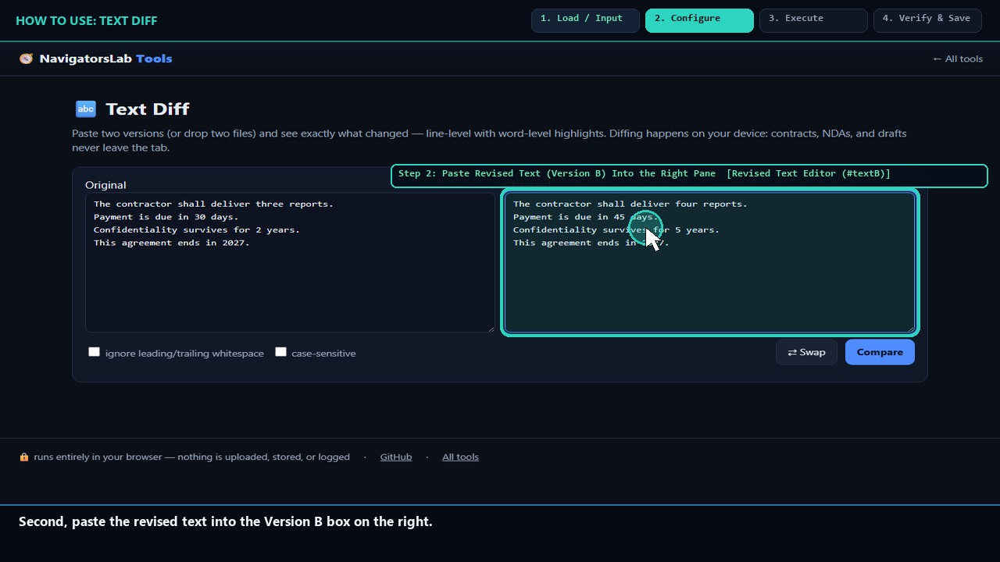
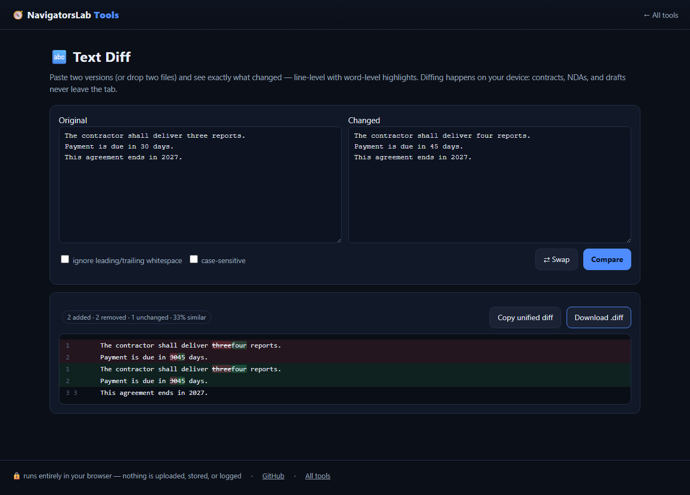

# 🔬 Text Diff

> Compare two texts with word-level highlights

     

<h4 align="center">
  &#9654; <a href="https://navigatorslab.com/tools/textdiff.html">Open it on navigatorslab.com</a> &mdash; free, no sign-up, nothing uploaded<br>
  <a href="https://navigatorslab.com/Text-Diff">navigatorslab.com/Text-Diff</a> &middot; <a href="https://navigatorslab.com/tools/videos/textdiff.mp4">🔊 Watch Narrated Step-by-Step Tutorial Video</a> &middot; <a href="https://navigatorslab.com/tools/videos/notebooklm-overview.mp4">Watch Full Suite Hands-On Video</a><br>
  This repo's Pages site runs the <em>actual tool</em>: <code>demo.html</code>
</h4>



Line diff with word-level highlights, similarity percentage, whitespace/case options, unified-diff export.

## 📖 Complete Step-by-Step User Guide

### Step 1: Paste Original Text (Version A) Into the Left Pane (`Original Text Editor (#textA)`)
- **How to do it:** Paste or type the baseline version of your contract clause, code snippet, or prose into `#textA`.
- **Expected result:** Original text is loaded in local browser memory.

### Step 2: Paste Revised Text (Version B) Into the Right Pane (`Revised Text Editor (#textB)`)
- **How to do it:** Paste the updated or redlined text into `#textB`.
- **Expected result:** Both versions are ready for Longest Common Subsequence (LCS) comparison.

### Step 3: Click Compare Texts to Inspect Word-Level Highlights (`Compare Button (#btnDiff) & Diff Output (#diffOut)`)
- **How to do it:** Click **Compare (`#btnDiff`)**. Inspect `#diffSummary` (added/removed line counts and similarity percentage) and `#diffOut`, where intra-line word changes are highlighted in green (`.w-add`) and red (`.w-del`).
- **Expected result:** Subtle single-word edits (like `30 days` → `45 days`) stand out immediately.

### Step 4: Export Standard Unified .diff Patch File (`Download .diff Button (#btnDl)`)
- **How to do it:** Click **Download .diff (`#btnDl`)** to save a standard unified diff file with `-` and `+` hunks.
- **Expected result:** Standard `.diff` patch file downloaded locally.

## 🎛️ UI Controls, Shortcuts & Parameters Reference

| Control / Shortcut | What It Does |
|---|---|
| `Version A (`#textA`) & Version B (`#textB`)` | Side-by-side text areas for original and revised text. |
| `Compare (`#btnDiff`)` | Runs the deterministic LCS diff algorithm with intra-line word highlighting. |
| `Diff Summary (`#diffSummary`) & Output (`#diffOut`)` | Shows similarity score, added/removed counts, and color-coded word diffs. |
| `Download .diff (`#btnDl`)` | Exports a standard unified `.diff` text file. |

## 💡 Pro Tips & Real-World Workflows

- 💡 Use Text Diff before signing a counter-party's 'clean final PDF' of an NDA or MSA: copy the text from your draft into `#textA` and the text from their PDF into `#textB` to catch silent edits.
- 💡 AI agents can also call this exact diff engine deterministically via `POST https://navigatorslab.com/tools/mcp` (`text_diff` tool).
- 💡 You can pre-populate inputs via URL parameters (`textdiff.html?a=...&b=...`).

## 🧪 Concrete Example: Input → Engine → Output

| Stage | What Happens | Details |
|---|---|---|
| **1. Raw Input** | **Contract-v1.txt vs Counterparty-Redline-v2.txt** | Counterparty claims 'minor typos fixed', but changed '30 days notice' to '90 business days notice' |
| **2. On-Device Engine** | **Custom Longest-Common-Subsequence (LCS) line + intra-line word diff engine highlights exact token mutations** | Runs 100% client-side in your browser tab under strict `CSP` (`connect-src 'none'`). |
| **3. Verified Output** | **Inline Word-Diff + Unified Patch (.diff)** | 91.4% similarity badge · '-30 +90 +business' highlighted inside line 14 · Exportable unified diff patch |

```text
@@ -14,1 +14,1 @@
-terminate with [-30-] {+90 business+} days written notice | Similarity: 91.4%
```

- 🔊 **Narrated Step-by-Step Usage Tutorial Video (`32s`):** [`demo.mp4`](./demo.mp4) (also live at [`https://navigatorslab.com/tools/videos/textdiff.mp4`](https://navigatorslab.com/tools/videos/textdiff.mp4))
- 🎬 **Full Suite Hands-On Video Guide:** [`https://navigatorslab.com/tools/videos/notebooklm-overview.mp4`](https://navigatorslab.com/tools/videos/notebooklm-overview.mp4)

## ✅ What it does

- Compare two texts with word-level highlighting inside changed lines
- Similarity percentage, whitespace/case options, unified-diff export
- Handles code, contracts and prose alike

## 🚀 Try it in 30 seconds

1. Paste both texts
2. Read word-level highlights and the similarity %
3. Export a unified diff

## 📸 Live UI in action



## 🔒 Private by design

- **100% on-device** — files are processed in your browser and **never uploaded** to any server
- **No accounts, no tracking, no cookies, nothing retained** — open the page and work
- **Works offline** once loaded; fully mobile-friendly
- **Free & open source (MIT)** — use it at home, at work, anywhere

## 🤖 Built for humans *and* AI agents

- Deep-linkable via URL parameters — see the [Agent Mode guide](https://navigatorslab.com/tools/agents.html)
- Machine-readable catalog: [llms.txt](https://navigatorslab.com/tools/llms.txt) · [llms-full.txt](https://navigatorslab.com/tools/llms-full.txt)
- MCP endpoint: `POST https://navigatorslab.com/tools/mcp` (tool catalog + deterministic text tools — see the [main repo](https://github.com/Kayforkind/NavigatorsLab-Tools))
- No build step required to *use* any tool — just the URL

## 🛠 Under the hood

Custom LCS diff with word-level intra-line highlighting

Third-party components are catalogued in [NOTICE](NOTICE); this repo is MIT-licensed ([LICENSE](LICENSE)).

## 🗂 The NavigatorsLab Tools suite

The full catalog — every tool in the hub with the same zero-upload promise, plus the lab's apps, CLIs and engines:

| Tool | What it does | |
|---|---|---|
| 🛡 Photo Privacy Kit | Strip GPS, camera model and timestamps before posting | [Open](https://navigatorslab.com/tools/exif.html) |
| 🔐 Password Breach Checker | Has this password been breached? — it never leaves your tab | [Open](https://navigatorslab.com/tools/breachcheck.html) |
| 🔍 Metadata & Hidden-Data Checker | See what's really inside a file — then strip it | [Open](https://navigatorslab.com/tools/metadata.html) |
| 🗜 Image Shrinker | Hit “max 2 MB” portal limits without TinyPNG | [Open](https://navigatorslab.com/tools/shrink.html) |
| 📄 Scan & Screenshot Cleaner | Phone photos of documents → clean, straight PDFs | [Open](https://navigatorslab.com/tools/scan.html) |
| ✍ Local E-Sign Pad | Sign this lease tonight — not DocuSign | [Open](https://navigatorslab.com/tools/sign.html) |
| 🧾 Receipts → One PDF | Shoebox of receipt photos → one date-sorted PDF | [Open](https://navigatorslab.com/tools/receipts.html) |
| 🔢 Receipt OCR → CSV | Read totals off receipt photos, export for expenses | [Open](https://navigatorslab.com/tools/ocr.html) |
| 🔳 QR Studio | Generate QR codes and decode QR images — no site sees them | [Open](https://navigatorslab.com/tools/qr.html) |
| 🎧 Audio Trimmer | Cut voice notes and clips on a waveform | [Open](https://navigatorslab.com/tools/audio.html) |
| 🧮 Invoice / Quote Generator | One-person shops: hours in, clean PDF out | [Open](https://navigatorslab.com/tools/invoice.html) |
| 🗂 Batch Rename & Sort | IMG_5847.jpg → 2026-09-05-receipt-home-depot.jpg | [Open](https://navigatorslab.com/tools/rename.html) |
| 🖨 Print-Shop Prep | Exact sizes, bleed, DPI checks, print-ready PDF | [Open](https://navigatorslab.com/tools/printprep.html) |
| 📑 PDF Pages | Reorder, rotate, delete and extract PDF pages | [Open](https://navigatorslab.com/tools/pdfpages.html) |
| **🔬 Text Diff** | Compare two texts with word-level highlights | [Open](https://navigatorslab.com/tools/textdiff.html) |
| 🎨 Reimagine | Redesign any HTML page from its own content | [Open](https://navigatorslab.com/reimagine/) |
| 📊 Text Stats | Words, reading time, readability, keyword density | [Open](https://navigatorslab.com/tools/textstats.html) |
| 📜 PDF Studio | Edit the text inside your PDF — private, free, open source | [Open](https://navigatorslab.com/pdf-studio/) |
| 🩺 Design Health | 18 deterministic design-quality checks for HTML — no LLM, no API key | [Open](https://github.com/Kayforkind/design-health-action) |
| 🔪 Skill Slice | Copy one Read-verified skill folder — a slice, not the pie | [Open](https://github.com/Kayforkind/skill-slice) |
| 🕵 liecatchers | Your agent said Done. Prove it — ten sensors, one RECEIPT.json | [Open](https://github.com/Kayforkind/liecatchers) |
| 📚 Book Guide MCP | Ship improvements with your books — agents cite, run playbooks, learn | [Open](https://github.com/Kayforkind/book-guide-mcp) |
| 📡 Data Insights | Founder intelligence — daily & weekly tech signal briefs | [Open](https://github.com/Kayforkind/data-insights) |
| 🪓 Iron Axe: Legacy | An original side-scrolling beat 'em up — Godot 4 | [Open](https://github.com/Kayforkind/iron-axe-legacy) |

---

<p align="center">
  <b>One hub, twenty-four projects:</b> <a href="https://navigatorslab.com/tools/">https://navigatorslab.com/tools</a><br>
  <b>Source &amp; the whole suite:</b> <a href="https://github.com/Kayforkind/NavigatorsLab-Tools">https://github.com/Kayforkind/NavigatorsLab-Tools</a>
</p>
